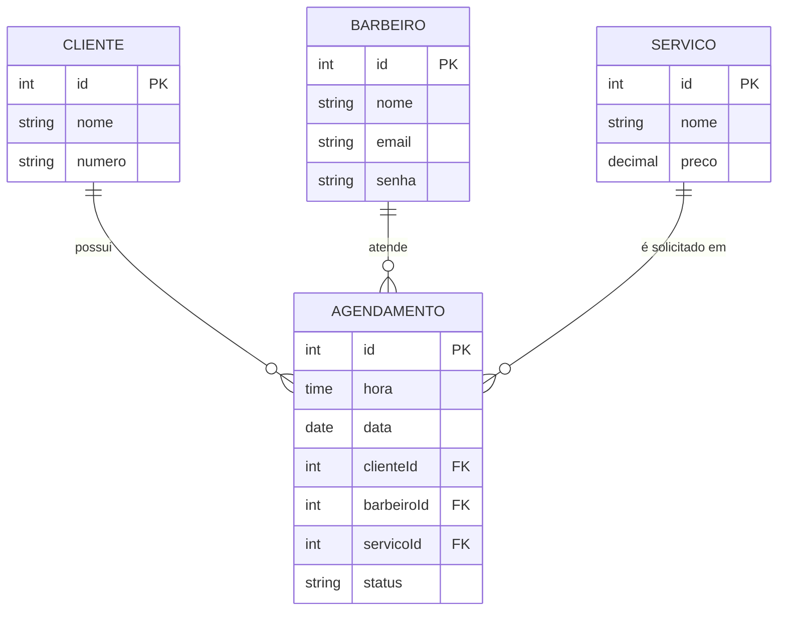

# Barber Shop API

API REST para gerenciamento de agendamentos de barbearia. Permite o cadastro de barbeiros, clientes e serviços, com autenticação de barbeiros via JWT, controle de acesso por proprietário do recurso e validação de conflito de horários.

## Visão geral

O fluxo principal da aplicação:

1. O cliente é cadastrado (`POST /cliente`) e recebe o `clienteId`.
2. O cliente consulta os barbeiros (`GET /barbeiro`) e os serviços (`GET /servico`) disponíveis.
3. O agendamento é criado (`POST /agendamento`) informando cliente, barbeiro, serviço, data e hora.
4. O barbeiro autentica-se (`POST /login`), consulta a própria agenda (`GET /agendamento/barbeiro`) e pode cancelar ou reativar os seus agendamentos (`PATCH /agendamento/status/{id}`).

O cliente não possui login: a área administrativa é restrita a barbeiros autenticados.

## Tecnologias

| Camada | Tecnologia |
|--------|------------|
| Runtime | Node.js |
| Framework | Express |
| ORM | Sequelize |
| Banco de dados | MySQL |
| Autenticação | JSON Web Token (`jsonwebtoken`) |
| Criptografia de senhas | bcrypt |
| Configuração | dotenv |

## Modelo de dados



O campo `status` aceita os valores `agendado` (padrão) e `cancelado`. O cancelamento é um *soft delete*: o registro é mantido no banco.

## Primeiros passos

### Pré-requisitos

- [Node.js](https://nodejs.org/) 24 (versão utilizada no desenvolvimento)
- [MySQL](https://www.mysql.com/) em execução

### Instalação

```bash
# 1. Clonar o repositório
git clone https://github.com/MarceloUrsulino/barber-shop.git
cd barber-shop/backend

# 2. Instalar as dependências
npm install
```

### Configuração

1. Crie o banco de dados no MySQL:

   ```sql
   CREATE DATABASE nome_do_banco;
   ```

   As tabelas são criadas automaticamente na primeira execução.

2. Crie o arquivo `.env` dentro de `backend/`, a partir do modelo:

   ```bash
   cp .env.example .env
   ```

   Preencha os valores conforme a seção [Variáveis de ambiente](#variáveis-de-ambiente).

### Execução

```bash
npm start
```

Ao iniciar com sucesso, o terminal exibe `Conectou` e a API fica disponível em `http://localhost:3000`.

## Variáveis de ambiente

| Variável | Descrição | Exemplo |
|----------|-----------|---------|
| `DB_NAME` | Nome do banco de dados | `barber_shop` |
| `DB_USER` | Usuário do MySQL | `root` |
| `DB_PASSWORD` | Senha do MySQL | — |
| `DB_HOST` | Host do MySQL | `localhost` |
| `JWT_SECRET` | Segredo usado para assinar os tokens JWT | string longa e aleatória |

## Autenticação e autorização

A autenticação usa **JWT** no esquema *Bearer*.

1. Faça login em `POST /login` com e-mail e senha.
2. Use o `token` retornado no header das rotas protegidas:

   ```
   Authorization: Bearer <token>
   ```

3. O token expira em **2 horas**. Após esse prazo, as rotas protegidas respondem `401` e é necessário fazer login novamente.

**Autorização:** além de autenticado, o barbeiro só pode alterar os **próprios** agendamentos. Tentar alterar o agendamento de outro barbeiro retorna `403`.

**Armazenamento de senhas:** as senhas são armazenadas com hash bcrypt (salt de 12 rounds) e nunca são retornadas pela API.

## Referência da API

URL base: `http://localhost:3000`

| Método | Endpoint | Descrição | Autenticação |
|--------|----------|-----------|:------------:|
| `POST` | `/barbeiro` | Cadastra um barbeiro | — |
| `POST` | `/login` | Autentica um barbeiro e retorna o token | — |
| `GET` | `/barbeiro` | Lista os barbeiros (`id` e `nome`) | — |
| `POST` | `/cliente` | Cadastra um cliente | — |
| `GET` | `/cliente` | Lista os clientes | Obrigatória |
| `POST` | `/servico` | Cadastra um serviço | Obrigatória |
| `GET` | `/servico` | Lista os serviços | — |
| `POST` | `/agendamento` | Cria um agendamento | — |
| `GET` | `/agendamento` | Lista todos os agendamentos (qualquer barbeiro autenticado) | Obrigatória |
| `GET` | `/agendamento/barbeiro` | Lista os agendamentos do barbeiro autenticado | Obrigatória |
| `PATCH` | `/agendamento/status/{id}` | Atualiza o status de um agendamento | Obrigatória |

### Cadastrar cliente

```http
POST /cliente

{
  "nome": "João Silva",
  "numero": "85 99999-9999"
}
```

**Resposta `201 Created`**

```json
{
  "message": "Cliente adicionado.",
  "clienteId": 2
}
```

### Login do barbeiro

```http
POST /login

{
  "email": "carlos@exemplo.com",
  "senha": "minhasenha"
}
```

**Resposta `200 OK`**

```json
{
  "message": "Você está conectado",
  "token": "eyJhbGciOiJIUzI1NiIs...",
  "barbeiroId": 1
}
```

### Criar agendamento

```http
POST /agendamento

{
  "hora": "14:00",
  "data": "15/11/2026",
  "clienteId": 1,
  "barbeiroId": 1,
  "servicoId": 1
}
```

**Resposta `201 Created`**

```json
{
  "message": "Agendamento criado."
}
```

A data é recebida no formato `DD/MM/AAAA` e armazenada no padrão ISO (`AAAA-MM-DD`).

### Listar a agenda do barbeiro

```http
GET /agendamento/barbeiro
Authorization: Bearer <token>
```

**Resposta `200 OK`**

```json
[
  {
    "id": 4,
    "hora": "14:00:00",
    "data": "2026-11-15",
    "clienteId": 1,
    "barbeiroId": 1,
    "servicoId": 1,
    "status": "agendado",
    "createdAt": "2026-11-01T14:40:36.000Z",
    "updatedAt": "2026-11-01T14:40:36.000Z"
  }
]
```

### Cancelar ou reativar agendamento

```http
PATCH /agendamento/status/4
Authorization: Bearer <token>

{
  "status": "cancelado"
}
```

**Resposta `200 OK`**

```json
{
  "message": "O status do agendamento 4 foi atualizado para cancelado"
}
```

## Regras de negócio e validações

- Todos os campos dos cadastros são obrigatórios.
- **Horário:** formato `HH:MM` (00:00 a 23:59).
- **Data:** formato `DD/MM/AAAA`.
- **Cliente:** o número de telefone é validado por expressão regular (padrão brasileiro).
- **Serviço:** o preço deve ser numérico e maior que zero; nomes de serviço não podem se repetir.
- **Barbeiro:** o e-mail deve ser único.
- **Agendamento:** o cliente, o barbeiro e o serviço informados devem existir.
- **Conflito de horário:** não é possível criar dois agendamentos ativos para o mesmo barbeiro, na mesma data e hora. Agendamentos cancelados não bloqueiam o horário.
- **Status:** apenas `agendado` e `cancelado` são aceitos.

## Tratamento de erros

Todas as respostas de erro seguem o formato:

```json
{
  "message": "Descrição do erro."
}
```

| Código | Significado | Quando ocorre |
|:------:|-------------|---------------|
| `200` | OK | Requisição processada com sucesso |
| `201` | Created | Recurso criado com sucesso |
| `401` | Unauthorized | Token ausente, inválido ou expirado |
| `403` | Forbidden | Autenticado, porém sem permissão sobre o recurso |
| `422` | Unprocessable Entity | Dados inválidos ou regra de negócio violada |
| `500` | Internal Server Error | Falha inesperada no servidor |

Os erros inesperados são capturados em todos os controllers, registrados no console do servidor e devolvidos ao cliente com uma mensagem genérica.

## Estrutura do projeto

```
barber-shop/
├── README.md
└── backend/
    ├── index.js
    ├── package.json
    ├── .env.example
    ├── controllers/
    ├── db/
    │   └── conn.js
    ├── middleware/
    │   └── checkToken.js
    ├── models/
    └── routes/
        └── routes.js
```

| Pasta | Responsabilidade |
|-------|------------------|
| `controllers/` | Regras de negócio e respostas HTTP |
| `models/` | Definição das entidades e associações (Sequelize) |
| `routes/` | Mapeamento dos endpoints para os controllers |
| `middleware/` | Verificação do token JWT |
| `db/` | Conexão com o banco de dados |

## Autor

**Marcelo Ursulino**
[GitHub](https://github.com/MarceloUrsulino) · [LinkedIn](https://linkedin.com/in/marceloursulino)
